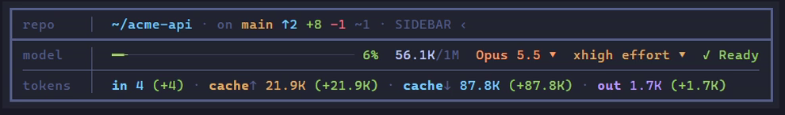
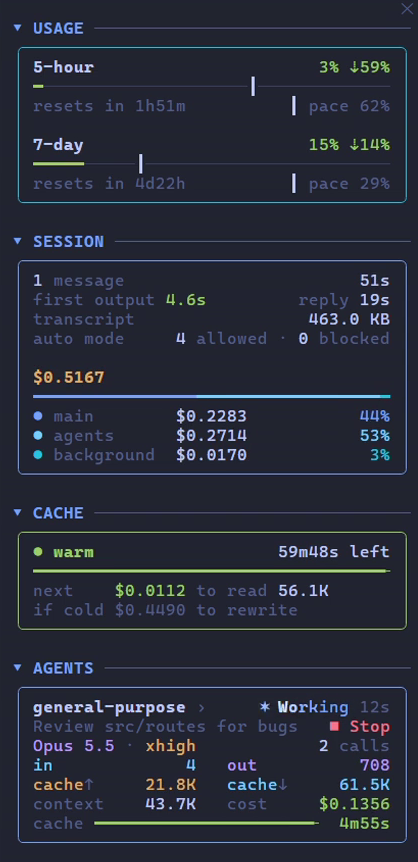
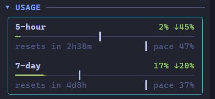
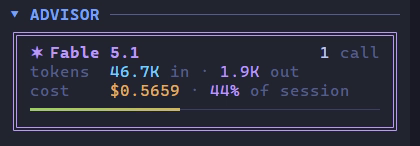
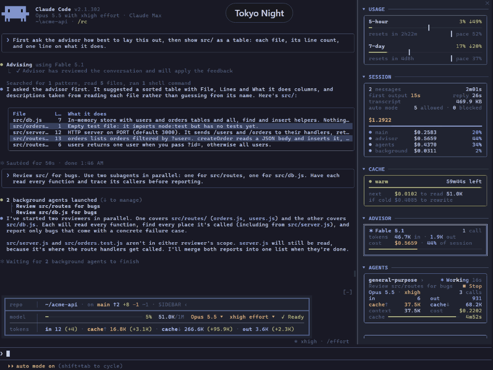

<div align="center">

# pitwall

**A pit wall for [Claude Code](https://claude.ai/code).**<br>
Live telemetry above your prompt, a side panel for cost, cache and agents,<br>
and fourteen themes that repaint all of Claude Code.


[Install](#install) · [The box](#the-box) · [The panel](#the-side-panel) · [Agents](#agents) · [Themes](#themes) · [Settings](#settings)

</div>

## Why

Claude Code shows you what it's doing. pitwall shows you what it's **costing**, and lets you act on it.

- **Cost by source.** The session's spend split into the main conversation, the advisor, subagents and background work.
- **Cache countdown.** How long until the prompt cache goes cold, and what your next message costs either way.
- **Rate limits with pace.** Whether you're ahead of or behind an even pace, and when each window resets.
- **Agents you can stop.** A card per subagent with its cost and tokens, and a stop button.
- **One-click model and effort.** Switch from the box, no slash command.
- **Fourteen themes.** They repaint Claude Code itself, the chat history and your terminal's colours.
- **Nothing leaves your machine.** No network calls. It reads only what Claude Code already writes.

Not a status line: a status line is a script run on every refresh. pitwall is a plugin that draws into Claude Code and reacts to its events, so every figure is live.

## Install

```text
/plugin install pitwall --marketplace axlaser/pitwall
```

Needs Claude Code 2.1.299 or later. Restart once to get the themes in `/theme`.

<details>
<summary>Shell, desktop app, update, uninstall</summary>

| | |
|---|---|
| Shell | `claude plugin install pitwall --marketplace axlaser/pitwall` |
| Desktop app | **+** by the prompt, **Plugins**, **Add marketplace** `axlaser/pitwall`, **Add plugin** |
| Update | `claude plugin update pitwall`, then `/reload-plugins` |
| Uninstall | `/plugin uninstall pitwall` |

</details>

## The box



| Row | Shows |
|-----|-------|
| **repo** | Path, branch, ahead/behind, insertions/deletions, stashes, and `SIDEBAR ›` |
| **model** | Context bar, tokens used, model `▾`, effort `▾`, and Claude's working animation |
| **tokens** | Session totals in, out and cached, with this turn's share |


Click the model or the effort to open its picker, pick, and `✓ Confirm`.

<details>
<summary>More about the box</summary>

- The context bar turns yellow at 60% and red at 85%. Past 85%, a `compact context` button appears.
- The box narrows with the terminal, dropping its least important figures first.
- **Windows:** paste a screenshot with **Alt+V** and `#N open ↗` opens it full size.
- `ctrl+x ctrl+a` hides and shows the box.

</details>

## The side panel



Docks beside the transcript in fullscreen mode. Open it with `/sidebar` or `SIDEBAR ›`.

It holds a card each for usage, the session, the cache, the advisor and every subagent. Click a section's name to fold it to one line.

<br clear="right">

<details>
<summary>Keys and sizing</summary>

- Drag its edge, or `ctrl+x ←` / `ctrl+x →`, to resize it; `ctrl+x x` closes it.
- Needs fullscreen mode (`"tui": "fullscreen"`) and 110 columns or more.
- At any width each card keeps its rows on one line.

</details>

### Usage



Your 5-hour and 7-day rate limits: how much is used, and when each window resets. The tick marks an even pace through the window, so a bar past its tick is spending faster than the limit lasts.

<br clear="right">

### Session


Messages, time to first output and to the full reply, transcript size, and auto mode's allowed and blocked calls. Then the session's cost, split between the main conversation, the advisor, subagents and background work, moving as each request lands.

<br clear="right">

### Cache


Whether the prompt cache is warm and how long until it goes cold. **next** is what your next message pays to read it; **if cold**, what it would pay to write it again. Every request resets the countdown.

<br clear="right">

### Advisor



Appears once Claude consults the advisor: its model, calls, tokens, cost and share of the session. A subagent's advisor calls count here too.

<br clear="right">

## Agents


Every subagent gets a card: its task, model, effort, tokens, cost and cache countdown, live while it works.

- **■ Stop**, then **■ Confirm**, stops a running agent.
- **✕ dismiss** clears a finished one. They also leave on their own after a minute, and slide back in if Claude resumes them.

<br clear="right">

**Click an agent's name** to open its transcript in the main view. **‹ main conversation** at the top of the panel goes back, and so does clicking its name again.


## Themes



Pick one in `/theme`. Each comes in dark and light: Tokyo Night, Dracula, Catppuccin, Gruvbox, Nord, Noir and Mono.

A theme paints Claude Code's own text and diffs, the box and panel, the chat history (tool calls as coloured rows, tables as cards), and the terminal's background and text colour. Any other theme keeps pitwall's classic look.

<details>
<summary>Terminal colours on Windows, or terminals without OSC 10 and 11</summary>

pitwall sets the background and text colour itself on macOS and Linux (VS Code, iTerm2, Ghostty, kitty, WezTerm). Elsewhere, set them by hand. In VS Code's `settings.json`:

```json
"workbench.colorCustomizations": { "terminal.background": "#1a1b26", "terminal.foreground": "#c0caf5" }
```

| Theme | Background | Text |
|-------|------------|------|
| Tokyo Night | `#1a1b26` | `#c0caf5` |
| Tokyo Day | `#e1e2e7` | `#3760bf` |
| Dracula | `#282a36` | `#f8f8f2` |
| Alucard | `#fffbeb` | `#1f1f1f` |
| Catppuccin Mocha | `#1e1e2e` | `#cdd6f4` |
| Catppuccin Latte | `#eff1f5` | `#4c4f69` |
| Gruvbox Dark | `#282828` | `#ebdbb2` |
| Gruvbox Light | `#fbf1c7` | `#3c3836` |
| Nord | `#2e3440` | `#d8dee9` |
| Nord Light | `#eceff4` | `#2e3440` |
| Noir | `#0a0a0a` | `#e8e8e8` |
| Noir Light | `#ffffff` | `#1a1a1a` |
| Mono | `#1c1c1c` | `#d0d0d0` |
| Mono Light | `#f2f2f2` | `#2a2a2a` |

If Claude Code crashes, `printf '\e]110\a\e]111\a'` restores your own colours.

</details>

## Settings

In `/config`, under pitwall:

| Setting | Default |
|---------|---------|
| Alert sounds | on |
| Context alert (%) | 70, 0 turns it off |
| Rate limit alert (%) | 80, 0 turns it off |
| Theme the chat history | on |
| Paint the terminal background | on |

Sounds play when Claude needs permission, finishes, compacts, or crosses an alert threshold.

## Troubleshooting

<details>
<summary><b>Nothing shows</b></summary>

Check `/plugin` lists pitwall as enabled and `claude --version` is 2.1.299 or later. Failures show as a dim `pitwall: …` line in the transcript; `claude --debug` logs the reason.

</details>

<details>
<summary><b>The box disappeared</b></summary>

`ctrl+x ctrl+a` hides it. Press it again.

</details>

<details>
<summary><b>No side panel</b></summary>

It needs fullscreen mode and 110 columns. `/sidebar` says why when it can't open.

</details>

<details>
<summary><b>Theme colours look washed out</b></summary>

Set VS Code's `terminal.integrated.minimumContrastRatio` to 1.

</details>

<details>
<summary><b>The screen is garbled</b></summary>

Resize the terminal, or bind `app:redraw` in `~/.claude/keybindings.json`:

```json
{ "bindings": [{ "context": "Global", "bindings": { "ctrl+x r": "app:redraw" } }] }
```

</details>

<details>
<summary><b>No sounds</b></summary>

Check the setting and your volume. Linux needs `paplay`, `ffplay` or `ogg123`.

</details>

## License

[MIT](LICENSE).
